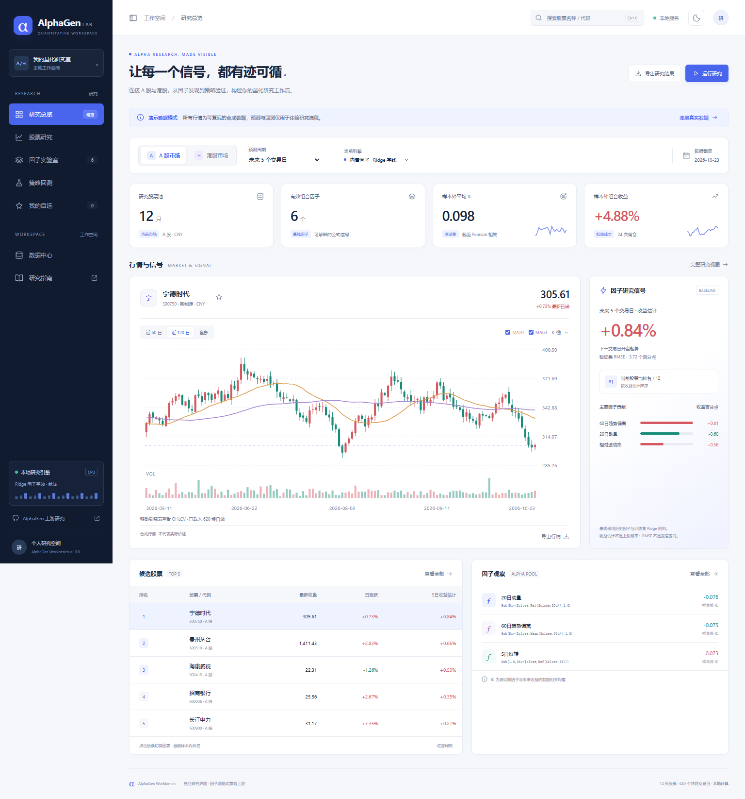

# AlphaGen Workbench · A-share and Hong Kong Stock Research

[简体中文](README.md) | **English**

A local, browser-based research workspace maintained at [Liu123215/alphagen-stock-workbench](https://github.com/Liu123215/alphagen-stock-workbench). It brings daily price charts, factor signals, stock ranking, imported factor-pool evaluation, and a simplified backtest into one interface.

> **What this version does:** version 1.0.0 starts with synthetic demonstration data and a fixed-factor Ridge baseline. It can fetch daily A-share and Hong Kong prices or import your CSV, and it can evaluate a supported subset of AlphaGen-style factor-pool JSON. It does not install or run upstream AlphaGen reinforcement-learning training, include a pretrained model, or reproduce the upstream Qlib engine bit-for-bit. The current application interface is in Chinese; this document translates the main workflows.



## Features

| Page | What you can do |
|---|---|
| 研究总览 — Overview | Switch market and horizon; see a price chart, factor contributions, estimates, and candidate rankings. |
| 股票研究 — Stock research | Select an instrument, inspect daily candles, moving averages, volume and history; export CSV. |
| 因子实验室 — Factor lab | Review expressions, weights, test-period IC and correlations; import or export factor-pool JSON. |
| 策略回测 — Backtest | Adjust position count and transaction cost, view the out-of-sample equity curve and export trades. |
| 我的自选 — Watchlist | Keep a local browser watchlist for A shares and Hong Kong stocks. |
| 数据中心 — Data center | Fetch daily bars, import or export CSV, inspect the source, or reset the current market. |

The theme and watchlist are stored in browser local storage. Market data and imported pools live in the local `data/` folder. The app binds to `127.0.0.1`, and does not require an OpenAI API key. Online data access needs an internet connection; the UI itself has no CDN or remote font dependency.

## Quick start on Windows

1. Download and extract the repository ZIP from GitHub using **Code → Download ZIP**, or clone the repository.
2. Install Python 3.10 or later and the Python launcher (`py`).
3. Double-click `SETUP.cmd` to create a local `.venv` and install NumPy and pandas. The setup script then launches the workspace.
4. On later starts, double-click `START.cmd`. It looks for the project `.venv`, a bundled Codex Python, and then system Python.
5. Open **http://127.0.0.1:8765** if a browser window does not open automatically.

Alternatively, run these commands in PowerShell from the project directory:

```powershell
py -3 -m venv .venv
.\.venv\Scripts\python.exe -m pip install -r requirements.txt
.\.venv\Scripts\python.exe app.py
```

Press Ctrl+C to stop a server started in the terminal. For a background server started by `START.cmd`, run:

```powershell
powershell -NoProfile -ExecutionPolicy Bypass -File .\STOP.ps1
```

If port 8765 is occupied, use `.\.venv\Scripts\python.exe app.py --port 8766` and open the corresponding address. Startup logs are in `data/server.log` and `data/server-error.log`.

## First research session

1. Select **A 股市场** (mainland A shares) or **港股市场** (Hong Kong) near the top of the page.
2. A red **演示行情** banner means the displayed prices are synthetic and do not match real quotations. To get actual daily bars, click **添加股票** (Add stock), enter a six-digit A-share code such as `000625`, or a five-digit Hong Kong code such as `00700`, and click **获取并研究这只股票**.
3. The first online selection also loads two reference stocks, because the factor model needs at least three stocks. To choose the whole universe, open **数据中心 → 在线获取日线** (Data center → Fetch daily bars) and enter 3–12 comma-separated symbols. Online fetching supports Shanghai/Shenzhen A shares and Hong Kong stocks; use CSV for Beijing Stock Exchange data.
4. Wait for fetching and calculation. Check **数据截至** and the date next to an instrument's closing price. The number is a daily close, not a real-time quote. The app tries to refresh an online market when it is opened; **更新在线行情** requests a manual refresh. On failure, the prior data is retained and an error is shown.
5. Go to **股票研究** to select an instrument and browse candles or history. Use **策略回测**, set positions and one-way costs, then click **重新回测**.
6. To use an existing pool, open **因子实验室 → 导入 AlphaGen JSON**, choose a JSON file and enter its actual mining-data cutoff date.

The top search only filters the loaded universe. An unknown custom symbol can be displayed as its code rather than its company name. A/H markets are kept separate and use CNY/HKD respectively.

## Data sources and price dates

The initial demo generates 620 weekdays for 12 A shares and 10 Hong Kong stocks with a fixed random seed. Prices are synthetic; its calendar does not model exchange holidays. Demo results cannot establish a model's real-world performance.

The online adapter requests roughly 640 daily bars from a public Tencent endpoint. It requests forward-adjusted data (`qfq`); some responses contain only `day`, for which adjustment status has not been independently verified. Those symbols are recorded in `sourceDetails` and shown in the data center. Volume remains in provider-native units. The application excludes today's bar before 17:00 China time; after that, it includes the bar only if the provider returns one. This policy is not a guarantee that the data source has finalized or published a bar.

Data can be delayed, unavailable, rate-limited or revised. One constituent failure aborts the batch and leaves the old dataset in place. The date on the screen is the latest **common date across the loaded stocks**, which can be earlier than an individual stock's latest date because missing or suspended days are not forward-filled. Verify the market, symbol, date and adjustment convention when comparing prices with another application.

### CSV import

Choose a market, then **数据中心 → 导入 CSV 文件**. The import replaces the current market's universe; it does not alter the other market. Save UTF-8 CSV with these mandatory columns:

```csv
date,symbol,open,high,low,close,volume
2025-01-02,000625,14.1,14.5,13.9,14.3,18500000
```

The snippet illustrates the format; it is not a complete importable dataset. Optional columns are `name`, `market` and `sector`. If provided, `market` must match the selected market (`CN` or `HK`), and a stock's name and sector must remain consistent.

- Supply 3–100 stocks, at least 180 bars per stock, up to 100,000 rows and a file under 10 MB. At least 180 dates must remain after common-date alignment.
- Dates use `YYYY-MM-DD` and cannot be later than the current China date. Import completed sessions only.
- Preserve leading zeroes: A-share codes have six digits; Hong Kong codes have five.
- Duplicate symbol/date rows, missing or non-finite OHLCV values, nonpositive prices or volume, and inconsistent high/low prices are rejected.
- Use a consistent adjustment and volume convention. The application cannot independently confirm your data's adjustment status.
- Validation and a trial analysis run before replacement. If the active pool is incompatible with the new data, restore the built-in baseline first.

## How forecasts and backtests are calculated

The built-in factors measure 20-day momentum, 60-day trend deviation, five-day reversal, 20-day relative volatility, relative volume, and intraday strength. Factors are normalized across stocks for each date, clipped to ±8 and used by a Ridge regression with penalty 10; the intercept is not penalized.

Dates are split chronologically into 60% training, 20% validation and 20% test. A training label must exit before the training boundary; a validation label must exit before the test boundary. Test data is not used to refit the model. The target for horizon `h` is:

```text
open[t + h + 1] / open[t + 1] - 1
```

The signal is produced after close on day `t`, entry is at the next common trading day's open, and exit is at the open after `h` holding periods. The UI supports 1, 5, 10 and 20 common trading-day horizons. The estimate is not an up-move probability or a forecast price path. Validation RMSE is an observed error summary, not a calibrated confidence interval.

The test-period backtest selects an equal-weight Top K basket every `h` days, fully liquidates at the end of each period, and charges the chosen one-way cost on both sides. The per-period net return is `(1 + gross_return) * (1 - cost) / (1 + cost) - 1`. The benchmark is the same universe equally weighted, without fees; it is not the CSI 300 or Hang Seng Index.

The chart samples equity at exits, so it can understate intra-period drawdown. Sharpe annualizes period returns using `252 / h` with a zero risk-free rate. The simulation omits actual trade availability, suspensions, price limits, lot sizes, minimum commissions, individual taxes, liquidity and FX. The current universe may have survivorship bias, and repeated tuning against the test period invalidates its independence. Results are for research and do not establish profitability.

## AlphaGen factor-pool import

[ICT-FinD-Lab/alphagen](https://github.com/ICT-FinD-Lab/alphagen) exports `exprs` and `weights` from `LinearAlphaPool.to_json_dict()`. Select a file in the factor lab and declare the market and the last date used to mine the factors. The declared date must not be later than this dataset's training cutoff; the app cannot independently verify that declaration.

```json
{
  "exprs": ["Sub(Div($close,Ref($close,20d)),1.0)"],
  "weights": [0.4],
  "market": "CN",
  "trained_until": "2024-01-01"
}
```

The pool can contain 1–20 expressions. Supported fields are `$open`, `$high`, `$low`, `$close` and `$volume`. Supported operators are `Abs`, `Sign`, `Log`, `Add`, `Sub`, `Mul`, `Div`, `Pow`, `Greater`, `Less`, `Ref`, `Delta`, `Mean`, `Sum`, `Std`, `Var`, `Max`, `Min`, `Med`, `Mad`, `Corr` and `Cov`. Positive integer lags/windows must be 1–120 days; `20d` syntax is accepted. `$vwap`, `CSRank`, `Rank`, `EMA`, `WMA`, `Skew` and `Kurt` are not supported and cause rejection rather than silent substitution. The interpreter uses an AST allowlist; it does not execute arbitrary Python.

Imported weights are retained for ranking after cross-sectional normalization. A single-variable calibration to returns is fitted on the training slice only. The independent implementation can differ from Qlib in normalization, missing-value handling and operator edge cases; real AlphaGen-trained pools have not been validated for numerical equivalence. `examples/pool-format-CN.json` is a manually authored format example, not a trained model. Upstream PPO training requires a separate, compatible Python/PyTorch/Qlib environment and properly prepared market-specific datasets.

## Export and troubleshooting

History, rankings, rebalance records and the full universe can be exported as CSV. Factor pools and the research report can be exported as JSON; the report excludes full OHLCV history. The browser controls where exports are saved. The `data/` directory is ignored by Git and contains local user data and logs.

| Issue | What to check |
|---|---|
| Price differs from another app | Ensure the banner is not demo mode; compare market, symbol, common as-of date and adjustment. This app shows daily closes, not live prices. |
| Symbol cannot be found | Search filters loaded stocks only. Use **添加股票** or change the online universe in Data center. Online universe limit: 12 stocks. |
| Fetch fails or shows old prices | Check network access, retry **更新在线行情**, or import a verified CSV. The old dataset remains on failure. |
| Startup fails | Install Python and dependencies; inspect `data/server-error.log`, data-directory permissions and port 8765. |
| Factor import fails | Verify the market, training cutoff, matching expression/weight counts and supported fields/operators. |

## Tests and project structure

```powershell
.\.venv\Scripts\python.exe -m unittest discover -s tests -v
```

Tests cover time-split leakage, delayed and non-overlapping trades, costs, formula restrictions, CSV validation, imported pool cutoffs, and market-data handling. `app.py` serves the local API, `engine.py` handles validation and research, `market_data.py` fetches online daily bars, and `static/` contains the UI. See the [Chinese README](README.md) for the complete file listing.

## Authors, copyright and licensing

This workbench is an independent project maintained in [Liu123215's repository](https://github.com/Liu123215/alphagen-stock-workbench); it is not an official AlphaGen or Kronos product. See [NOTICE.md](NOTICE.md) for the upstream AlphaGen research authors, the Kronos original author's copyright notice, and the distinction between the source projects and this implementation.

No open-source license is currently included for this repository. Public visibility does not by itself grant an open-source license or permission to redistribute its contents. Upstream materials remain subject to their own terms.
