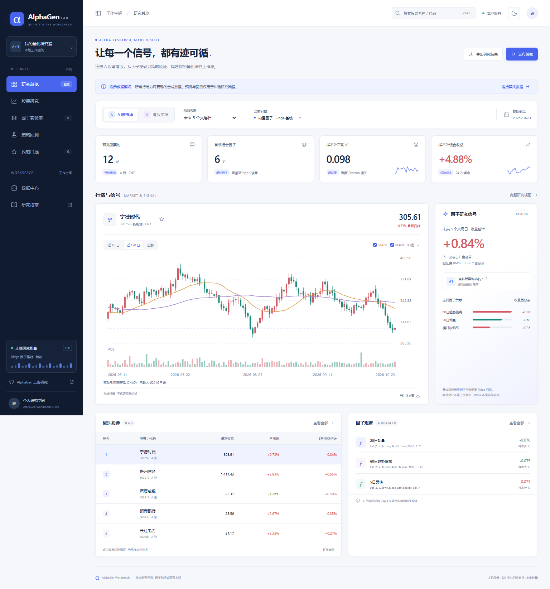

# AlphaGen Workbench · A 股 / 港股研究工作台

**简体中文** | [English](README.en.md)

本地运行的中文浏览器研究工作台，延续你已有的 Kronos 工作台布局，提供行情图表、因子信号、候选排序、因子池评估和样本外回测。

**版本 1.0.0 是可运行的独立研究版。默认使用合成演示行情和固定因子 + Ridge 基线，没有安装或运行上游 AlphaGen 的强化学习训练，也没有预训练权重。** 可以在线获取 A 股、港股日线，也可以导入真实日线 CSV；支持上游 AlphaGen JSON 因子池的部分公式，进行本地兼容评估。兼容格式不等于上游训练或与 Qlib 数值完全一致。



## 在这台 Windows 电脑上启动

双击 **`START.cmd`**。启动器会依次寻找项目 `.venv`、当前 Codex 随附的 Python 和系统 Python。发现可用的 NumPy、pandas 环境后，在后台启动本地服务并打开浏览器：

**http://127.0.0.1:8765**

- 本机已有服务时再次双击只打开网页。
- 关闭浏览器不会停止服务。停止时可在 PowerShell 运行 `powershell -NoProfile -ExecutionPolicy Bypass -File .\STOP.ps1`。
- 可直接运行 `python app.py`，终端里按 Ctrl+C 停止。
- 端口冲突时运行 `python app.py --port 8766`，打开对应地址。
- 全部计算和导入文件保存在本机 `data/`，服务仅监听 `127.0.0.1`。不需要 OpenAI API Key。

## 在其他电脑上安装

需要 Python 3.10+。安装 Python 时勾选 Python Launcher，再双击 `SETUP.cmd`：建立 `.venv`、安装 `requirements.txt` 并启动。

也可以手动安装：

```powershell
py -3 -m venv .venv
.\.venv\Scripts\python.exe -m pip install -r requirements.txt
.\.venv\Scripts\python.exe app.py
```

只依赖 NumPy 和 pandas。界面不依赖 Node.js、CDN 或在线字体；演示模式和 CSV 研究可离线运行，在线行情获取需要网络。

## 第一次使用：从演示到真实行情

1. 双击 `START.cmd`。如果提示缺少 Python 或依赖，先安装 Python 3.10+，再双击 `SETUP.cmd`。
2. 浏览器显示“演示行情”时，价格是合成数值。先在顶部选择 **A 股市场**或**港股市场**。
3. 点击右上角 **添加股票**，输入完整代码，例如 A 股 `000625` 或港股 `00700`，点击“获取并研究这只股票”。首次使用会同时加载另外两只参考股。也可在 **数据中心 → 在线获取日线**指定 3～12 只股票组成股票池。
4. 等待获取和计算结束；查看顶部的“数据截至”和个股价格旁的日期。已有在线数据的市场在页面打开时会尝试刷新，也可以点击“更新在线行情”。
5. 在 **股票研究**中切换股票、查看历史 K 线及明细；在 **策略回测**中设置持仓数与单边成本，点击“重新回测”。
6. 若需使用已有的 AlphaGen 因子池，在 **因子实验室 → 导入 AlphaGen JSON**选择文件，并填写真实的因子挖掘截止日期。

界面当前为中文；英文 README 提供对应的操作翻译。自定义股票没有匹配到内置名称时会以代码显示。

## 已实现功能

| 页面 | 能做什么 |
|---|---|
| 研究总览 | 市场切换、样本外概况、K 线 / 收盘线、均线、成交量、收益估计、因子贡献和候选股 |
| 股票研究 | 按名称 / 代码搜索、切换股票、历史行情分页、CSV 导出 |
| 因子实验室 | 公式、权重、测试期 IC、相关矩阵、JSON 因子池导入 / 导出 |
| 策略回测 | 持有周期、持仓数、成本参数、样本外净值、调仓记录和导出 |
| 我的自选 | 浏览器本地保存 A 股 / 港股自选列表 |
| 数据中心 | 在线日线、CSV 校验导入、数据来源和日期、重置、训练接入说明 |

另有深浅主题、Ctrl+K 搜索、手机 / 平板布局、完整研究 JSON 导出。A 股 / 港股独立管理，币种分别为 CNY / HKD；红涨绿跌。

## 先体验，再换真实数据

默认 A 股 12 只、港股 10 只，620 个工作日；固定种子合成，**不是任何公司的历史真实价格，也不能用于判断模型有效性**。演示日历仅含周一到周五，没有模拟交易所节假日。

### 在线获取

点击页面右上角「添加股票」，输入 A 股或港股代码即可加入研究池。首次使用时系统会另外选择两只参考股票；也可以进入「数据中心 → 在线获取日线」，一次输入 3～12 只代码并调整整个股票池。

- A 股：6 位，如 `600519,000625,300750`；目前适配沪深，北交所使用 CSV。
- 港股：5 位，如 `00700,09988,03690`。
- 请求腾讯公开接口约 640 根日线，北京时间 17:00 后才纳入源站已提供的当天日线，早于 17:00 显示最近已完成日线。
- 请求口径为前复权。源站部分股票仅返回 `day`；程序会记录这些代码，其复权状态**未独立核验**，可在数据中心和研究 JSON 的 `sourceDetails` 查看。不会静默声称所有股票都已确认前复权。
- 成交量保留源站单位；基线使用同股量比，不跨股票比较绝对成交量。用户应核验数据含义与企业行动。
- 未内置名称的自定义股票以代码显示。
- 接口没有可用性保证，可能超时、限流或变更。任一股票失败则整批不保存，保留原数据，不回退合成行情。
- 这是日线快照，不是实时行情。打开已有在线数据的市场时会尝试自动更新，也可点页面顶部“更新在线行情”；更新失败时保留旧数据并报错。页面始终显示数据截至日。

### 导入 CSV

每次替换当前市场的整个股票池，另一市场不受影响。使用 UTF-8 编码，必需列：

```csv
date,symbol,open,high,low,close,volume
2025-01-02,000625,14.1,14.5,13.9,14.3,18500000
```

可加 `name,market,sector`；同一股票名称和行业需一致。`market` 如提供必须统一为 `CN` 或 `HK`。

校验条件：

- 3～100 只股票，每只至少 180 根日线；最多 100000 行、文件小于 10MB。
- 日期必须 YYYY-MM-DD，不能晚于北京时间今天。建议仅导入收盘完成数据。
- 代码保留前导零。不要先用 Excel 转为数字后再保存。
- 不接受重复股票 / 日期、缺失值、非有限值、非正价格、成交量 ≤ 0、错误 OHLC。
- 各股票使用一致的复权口径与成交量单位；系统不能独立验证复权真实性。
- 只保留同一市场所有股票共有的日期，不前向填充缺失行情。共同日期至少 180 天。
- 导入前完整校验及试算，失败保留原数据。已有池与新数据不兼容时先在因子实验室恢复内置基线。

## 预测、因子与回测是怎样计算的

### 默认基线

固定公式：20 日动量、60 日趋势偏离、5 日反转、20 日相对波动率、量比和日内强弱。每天在股票池内做横截面 Z-score，裁剪到 ±8；不把缺失因子填成零。

前 60% 日期拟合 Ridge 回归（正则强度 10，截距不惩罚）；中间 20% 计算验证误差；后 20% 用于样本外评价，不重新拟合参数。训练标签的离场日期必须早于训练边界；验证标签的离场日期必须早于测试边界。

标签为：`open[t+h+1] / open[t+1] - 1`。即 t 日收盘获得因子，下一交易日开盘入场，持有 h 个共同交易日，到 t+h+1 日开盘离场。页面的 1 / 5 / 10 / 20 日均指此口径。

最新收益估计不是下一收盘价预测，不是上涨概率；基线没有价格路径生成。验证集 RMSE 是历史均方根误差，不是经过校准的置信区间。

### 导入 AlphaGen 池

上游：<https://github.com/ICT-FinD-Lab/alphagen>。其 `LinearAlphaPool.to_json_dict()` 包含 `exprs` 和 `weights`。

在「因子实验室 → 导入 AlphaGen JSON」选择文件，声明市场和因子挖掘数据截止日。截止日不得晚于工作台显示的训练截止日，避免明显的测试泄漏；用户声明无法独立证明上游训练没有泄漏。已有元数据与填写值冲突时拒绝导入。

```json
{
  "exprs": ["Sub(Div($close,Ref($close,20d)),1.0)"],
  "weights": [0.4],
  "market": "CN",
  "trained_until": "2024-01-01"
}
```

最多 20 个因子。支持字段 `$open,$high,$low,$close,$volume`，支持算子：

`Abs, Sign, Log, Add, Sub, Mul, Div, Pow, Greater, Less, Ref, Delta, Mean, Sum, Std, Var, Max, Min, Med, Mad, Corr, Cov`。

仅支持 1～120 日的正滞后 / 窗口，接受上游 `20d` 形式。不支持 `$vwap`、CSRank、Rank、EMA、WMA、Skew、Kurt 等公式，遇到会明确拒绝，不丢弃因子、不替换模型。公式经 AST 白名单解释，禁止任意 Python 代码与未来引用。

导入模式保留原权重，用每日归一化因子的加权和排名；收益估计由训练集上拟合的单变量线性标定给出。**此处是独立兼容解释器，缺失值处理、归一化、算子边缘情形可能与上游 Qlib 不同，尚未验证真实训练产物的数值一致性。** 不应将其当作复现上游论文结果。

`examples/pool-format-CN.json` 只是手写格式示例，没有经过强化学习训练。界面不会把它标成预训练模型。

### 上游训练接入边界

此版本没有 PPO 训练按钮，没有后台训练进程，没有自动下载上游依赖。要使用上游挖掘能力，需要按其仓库说明单独配置匹配的 Python / PyTorch / Qlib 环境、准备完整股票池数据、仅在训练日期内挖掘后导出 JSON。港股需要自行准备相应数据和交易日历，不能沿用 A 股数据目录。

未打包上游代码，避免把旧依赖或未经确认的授权条款混入当前程序。后续接入完整原生训练需要针对实际数据和硬件验证。

### 回测假设

测试期每 h 个共同交易日，用当时信号选择 Top K，等权买入，无重叠仓位。每次先全额清仓再买入；买卖两侧都扣用户设定的综合成本。单期净收益：

`(1 + gross_return) * (1 - cost) / (1 + cost) - 1`。

默认单边 15 bps 是可调研究参数，不代表 A 股或港股实际税费。参考基准是同一股票池同期等权收益，未扣成本，不是沪深 300 或恒生指数。

- 净值只在调仓点记录，最大回撤会漏掉持有期内波动，可能低估。
- 夏普按周期收益、252 / h 折年、无风险利率 0 计算，不是完整日频组合夏普。
- 未模拟停牌、涨跌停、盘口、每手股数、最小佣金、交易税分项、实际成交量限制、汇率。
- 当前股票池并非历史时点可投资全市场，可能有生存偏差；导入因子也可能存在挖掘偏差。
- A 股和港股独立回测，不跨市场合并货币与交易日。
- 测试结果用于研究，不能证明策略可获利；反复根据测试结果调参会污染测试结论。

## 导出与保存

- 股票页：历史行情 / 排名 CSV。
- 因子页：包含市场、训练截止日的因子池 JSON。
- 回测页：每次调仓记录 CSV。
- 顶部：完整研究 JSON，含数据来源、参数、时间切分、预测、因子、指标及回测结果，不含全量 OHLCV。
- 数据中心：完整股票池 CSV。
- 导出通过浏览器的保存设置选择目录；可按需要选择云盘或本地目录。
- 自选与主题在浏览器 localStorage；行情 / 因子池在项目 `data/`。更换浏览器不会迁移自选。

## 常见问题

**为什么价格和行情软件的当前价格不同？** 工作台展示日线收盘价，并非盘中实时价。先确认不是红色的演示行情，再核对个股价格旁的日期、市场、股票代码和复权口径。在线日线仅在北京时间 17:00 后尝试纳入当天记录；节假日、股票停牌、共同日期对齐、数据源延迟或更新失败都可能使截至日期更早。页面显示的截至日期是股票池共同日期，不保证是每只股票各自最新的可用日期。

**为什么搜索不到股票？** 顶部搜索只查找已经载入的股票池。点击“添加股票”输入 A 股 6 位或港股 5 位代码；在线池已达 12 只时，在数据中心重新设置股票池。在线源目前不支持北交所，请导入 CSV。

**点击启动后没有打开页面？** 查看 `data/server-error.log`；确认 Python 及依赖已安装，并检查 8765 端口是否被占用。也可使用 `.\.venv\Scripts\python.exe app.py --port 8766` 手动启动并打开该地址。

**在线获取失败或行情没有更新？** 公共源可能超时或限流。程序会保留旧数据并显示错误；等待后点击“更新在线行情”，或导入自行核实的 CSV。检查 `data/` 的写入权限；更换机器时不会自动迁移本地数据。

**为什么不能导入某个因子池？** 检查市场、截止日期、表达式与权重数量；本地解释器只支持上文列出的字段和算子，不支持的表达式会被拒绝。示例 JSON 只是格式示例，不是训练模型。

**能否直接用结果交易？** 此工具用于因子和回测研究。收益估计不是上涨概率，示例模型未经证明适合真实交易；回测还省略了交易限制和部分费用，应独立核验。

## 验证

```powershell
python -m unittest discover -s tests -v
```

测试覆盖未来价格不影响训练权重、滞后与非重叠成交、成本影响、公式代码注入和前视阻断、CSV 校验、池权重与训练日期、A/H 多周期有限值输出。浏览器实测覆盖页面、股票切换、自选、回测参数、市场切换、弹窗、深浅主题和多个宽度。真实在线接口的可用性需以当前网络为准。

## 文件结构

```text
app.py              本地 HTTP 服务与原子保存
engine.py           数据验证、公式解释、训练与回测
market_data.py      手动在线行情获取
static/             HTML / CSS / JavaScript / SVG 图表
tests/              计算与数据测试
examples/           因子池格式示例
START.cmd           双击启动入口
Launch.ps1          后台启动与打开浏览器
SETUP.cmd           其他电脑安装入口
STOP.ps1            停止本启动器管理的服务
requirements.txt    Python 依赖
NOTICE.md           上游研究、作者与数据来源
data/               用户本地状态与日志（运行时生成）
```

## 作者、版权与许可

工作台由 [Liu123215](https://github.com/Liu123215) 的仓库维护；它是独立研究界面，并非 AlphaGen 或 Kronos 官方产品。AlphaGen 上游论文作者为 Shuo Yu、Hongyan Xue、Xiang Ao、Feiyang Pan、Jia He、Dandan Tu 和 Qing He。界面参考的 Kronos Windows 项目所含模型核心的原版权声明为 **Copyright (c) 2025 ShiYu**。本工作台未打包该模型代码或权重。完整署名及各项目的版权范围、许可说明见 [NOTICE.md](NOTICE.md)。本仓库目前未附开源许可证；公开可见不代表已授予任意复制或再分发许可。
